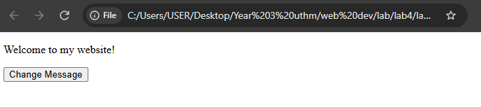
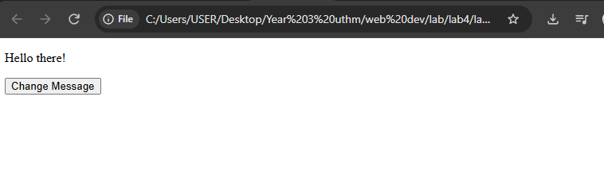
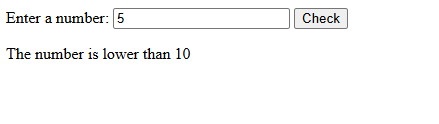
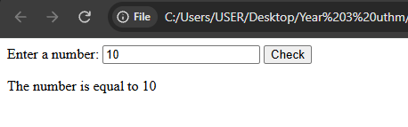
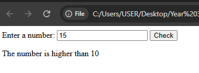
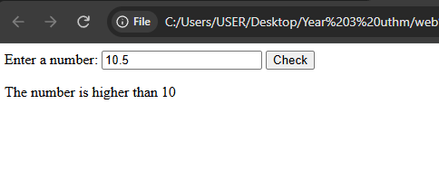
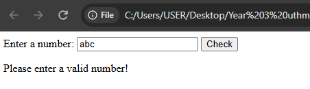
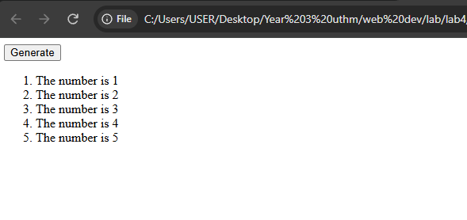

# bic21203-lab4a-javascript
AI240009 S4 LAB 4a

# BIC21203 Web Development - Lab 4a

**Name:** Muhammad Khairi bin Jalil  
**Student ID:** AI240009  

## Brief explanation
This repository contains solutions for Lab 4a: Client-Side Scripting (JavaScript). 
It covers DOM manipulation, event handling, input validation and loops across three interactive web page tasks.

## Instructions
1. Download or clone this repository to your local machine.
2. Navigate to the specific folder (Q1, Q2, or Q3).
3. Double-click the `_____.html` file to open it in any modern desktop browser.
4. Interact with the buttons and input fields to view the JavaScript outputs.

## Screenshots of the outputs

**Question 1:**

**Question 2:**

**Question 3:**

